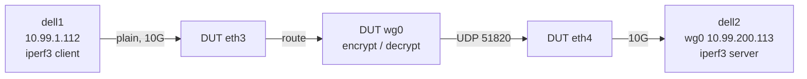
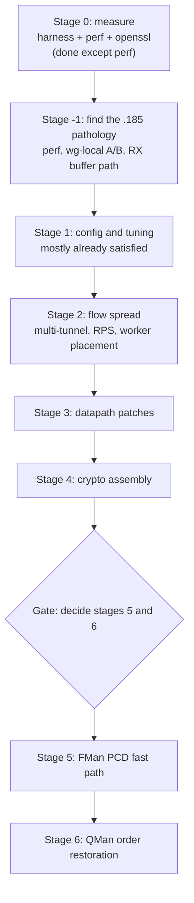

# ASK2 WireGuard Throughput Plan

**Status: open, 2026-10-12.** Stage 0 is measured and the stage -1 cause is found: the `.185` shortfall was a lockdep/KUnit debug kernel, not WireGuard or DPAA. On the production image `.185` is level with `.106`.

WireGuard cannot be hardware-offloaded on the LS1046A: FMan cannot see inside the tunnel and the SEC (CAAM Era 8) has no ChaCha20-Poly1305. WireGuard therefore always runs in software on the four A72 cores. This plan covers how to raise that software throughput on the ASK2 image (`.185`), what the vendor ASK image (`.106`) achieves for comparison, and which of the proposed optimisation stages are worth doing.

It replaces an earlier modelled plan (stages 0 to 6, 1.4 to 4.0 to 5.5 Gbit/s) whose figures were derived from published cycle counts and comparable hardware, not measured on this board. The measurements below change the order of work and remove one stage.

## 1. Role and test rig

The board is a gateway: it forwards traffic into and out of a tunnel it terminates, and the endpoints live elsewhere.



- **Harness:** `bin/testrig-wireguard.sh`. Cells `plain-v4`, `wg-v4`, `wg-v6`, `ceiling-v4`; directions `up` (DUT encrypts), `down` (DUT decrypts), `bidir`; `MODE=udp` for packet-rate runs; `DUT_KIND=ask2` for `.185`, `DUT_KIND=vendor` for `.106`. Everything is runtime-only and removed by an EXIT trap.
- **`ceiling-v4`:** dell1 to dell2 over the ConnectX-3 link with no DUT. It measures the generator pair's own WireGuard limit so a DUT result is never generator-limited.
- **Inner/outer addressing:** inner `10.99.200.0/24` and `fd99:200::/64`, outer `10.99.2.185` to `10.99.2.113` (IPv6 outer with `OUTER=6`). Tunnel MTU 1420, pinned on the dell1 route so no path-MTU discovery is involved.
- **`.106` prerequisite:** the stock image has no `wireguard.ko`. Installed 2026-10-12 with OpenWrt attended sysupgrade: `owut download --force -a "kmod-wireguard wireguard-tools" -k` then `owut install` (one `-a` only, quote the list). The ASK modules and `cmm` survived. OpenWrt's fw4 has no zone for `wg0`, so the harness inserts runtime accept rules (comment `wgrig`) in `inet fw4 forward` and removes them in teardown.

## 2. Measured baseline (stage 0)

16 s runs, 4 TCP streams, MTU 1420, one direction.

| DUT | Direction | Throughput | DUT CPU | Notes |
|---|---|---|---|---|
| `.106` vendor ASK, kernel 6.12.103 | up | 1.54 Gbit/s | about 90% | 383k retransmits |
| `.106` | down | 1.34 Gbit/s | about 72% | 287k retransmits |
| `.185` ASK2, kernel 6.18.55 | up | about 0.13 to 0.16 Gbit/s | 67 to 69%, one core pegged | 0 retransmits, RTT 7.7 ms under load |
| dell1 to dell2, no DUT | up | 5.0 Gbit/s | n/a | about 1M retransmits |

Crypto cost, measured with `openssl speed` (the same CRYPTOGAMS assembly the model assumed), pinned to one core on `.185`:

| Item | Model | Measured |
|---|---|---|
| Core clock | 1.8 GHz | 1.6 GHz (performance governor) |
| ChaCha20-Poly1305, 1424 B | 5.3 cycles/byte, 2.7 Gbit/s | 6.45 cycles/byte, 248 MB/s, about 2.0 Gbit/s |
| ChaCha20 alone | 4.2 cycles/byte | 5.2 cycles/byte (309 MB/s) |
| Four-core crypto ceiling | 10.9 Gbit/s | about 7.9 Gbit/s |
| Crypto per 1420 B packet | about 7,600 cycles | about 9,300 cycles |

### 2.1 Stage -1 result: the board was running a debug kernel

Profiling `.185` with `perf record -a -g` (static `perf` built natively from the 6.18.55 tree, copied to `/tmp/perf`) showed the time in lockdep, not crypto. The top symbols were `__local_bh_enable_ip` (15%), `finish_task_switch` (8.6%), `lock_acquire` (8.3%), `lock_is_held_type` (6.6%), `lock_release` (3.8%), `rcu_is_watching`, `rcu_lockdep_current_cpu_online` and `debug_lockdep_rcu_enabled`; `chacha_4block_xor_neon` was 2.3%. The running kernel config had `CONFIG_PROVE_LOCKING=y`, `PROVE_RCU`, `DEBUG_SPINLOCK`, `DEBUG_MUTEXES`, `DEBUG_LOCK_ALLOC`, `TRACE_IRQFLAGS` and `DEBUG_LIST`.

Cause: image `2026.10.11-0348-rolling` (and `0257`) were built with the opt-in KUnit debug input (`bin/ci-setup-kernel.sh`, lines near 959 to 979, `kernel/ask/kernel-config/90-kunit.config`). The earlier "no debug options" check was wrong because the config grep was truncated with `head -30`. Both debug images have a vmlinuz about 0.8 MB larger than the production ones (14.6 MB against 13.8 MB), and `zcat vmlinuz | grep -ac "Lock dependency validator"` is 1 for them and 0 for `2340`. **The `latest.iso` on lxc200 pointed at the 0348 debug build.**

A/B on the same board, rig and harness settings (16 s, 4 streams, MTU 1420, TCP):

| Kernel | up (DUT encrypts) | down (DUT decrypts) | Notes |
|---|---|---|---|
| `0348` debug (PROVE_LOCKING) | 0.13 to 0.16 Gbit/s | not measured | 68% CPU, lockdep symbols about half of all samples |
| `2340` production | **0.90 Gbit/s** | **1.34 Gbit/s** | up: one core at 99%, 0 retransmits; down: 85% CPU, 9k retransmits |
| `.106` vendor (for reference) | 1.54 Gbit/s | 1.34 Gbit/s | |

So the debug kernel cost about 6 times on `up`. The measured `.185` numbers in the table above are debug-kernel numbers; use the `2340` rows from now on.

Profile of the production kernel, `up` direction (`/tmp/prod.data` on `.185`):

- `kworker/*+wg-crypt-wg0` on CPU 3 is the single serial `wg_packet_tx_worker` (about 26% of all samples, one CPU saturated). The parallel `wg_packet_encrypt_worker` stage is about 29% spread over the cores; `chacha_4block_xor_neon` plus `poly1305_blocks_neon` plus `chacha_permute` are about 20%. Crypto is now the largest single cost but the cap is the serial stage.
- Inside the serial tx worker, `wg_socket_send_skb_to_peer` is 24% inclusive, `udp_tunnel_xmit_skb` 20%, and **`nf_hook_slow` 19%** (nftables chains `nft_do_chain` 6.5%, plus VyOS firewall/conntrack hooks), `dev_hard_start_xmit` 11%. About three quarters of the serial stage is netfilter and output path, not WireGuard.
- Experiment: `WG_NOTRACK=1` (outer UDP 51820 untracked in an `inet wgnt` table at priority -300) gave `up` 0.94 Gbit/s (+4%) and `down` 1.53 Gbit/s (+14%, more reordering retransmits). Conntrack for the outer flow is therefore not the main cost; the nftables rule evaluation on the output and postrouting hooks is.

Consequences for the stages: stage 1 changes from "already satisfied" to "was violated": production images must not carry the KUnit debug config, and the harness must record the kernel config (stage 1 item 2). The serial tx stage, netfilter cost on the outer packets, and WireGuard's in-order stage are what stage 2 and 3 now attack. The crypto-assembly stage is worth more than first thought because crypto is already the top single cost.

Findings that shaped the plan before the stage -1 result (items 2 to 5 are superseded by 2.1; the numbers in them are debug-kernel numbers):

1. **`.106` is within the model's stage-0 range** (about 44k cycles per packet against 17 to 22k modelled, with heavy reordering retransmits).
2. **`.185` is about 10 times worse than `.106` and about 18 times worse than the model.** 128 Mbit/s is about 11k packets per second; with about 2.7 cores busy at 1.6 GHz that is roughly 390k cycles per packet. At 248 MB/s per core, crypto for that traffic needs about 6% of one core. **Crypto is not the bottleneck on `.185`; something in the packet path is.**
3. During load on `.185` the top consumers were `kworker/*+wg-crypt-wg0` (69% on one CPU) and `napi/wg0` (42%), with high system time rather than softirq time.
4. **Ruled out on `.185`:** debug/tracer options (`PREEMPT_NONE`, no tracers, no lock debugging) and generic-C crypto (the NEON `chacha_4block_xor_neon` and `poly1305_blocks_neon` symbols are present in `libchacha` / `libpoly1305`; that they are used at runtime is not yet confirmed).
5. **Not yet ruled out:** cache maintenance on the DPAA RX buffers (the live device tree has no `dma-coherent` node), per-packet buffer copies or `skb_cow_data`, and placement of the wg crypt workers relative to the `dpaa-rps` mask (`0xe`, CPUs 1 to 3).
6. The dell-to-dell ceiling of 5.0 Gbit/s with about 1M retransmits is not a clean ceiling: one tunnel is one UDP 5-tuple, so the X710 hashes it to one RX queue, and WireGuard's parallel crypto reorders packets. Treat it as a lower bound until multi-tunnel and UDP runs exist.

### 2.2 Validated numbers (production kernels, two independent sessions)

Method: `REPS=3 DUR=30 STEADY_FROM=10 STREAMS=4`, TCP, MTU 1420, steady-window mean, performance governor at 1.6 GHz on both DUTs, lock debugging absent (the harness now records the kernel and refuses to run on a lockdep kernel; zero-traffic reps are retried and never averaged). Files: `/mnt/builds/ask2-review/oracle/wg-validated-{185,106}{,-s2}.csv`. Gbit/s, mean of 3 reps; the spread inside a session is under 0.06, the spread between sessions is the placement effect in 2.3.

| DUT | Cell | up | down | bidir |
|---|---|---|---|---|
| `.185` image 0117, session 1 | wg-v4 | 0.88 | 1.36 | 1.14 |
| `.185` session 2 | wg-v4 | 1.02 | 1.41 | 1.49 |
| `.185` session 1 / 2 | wg-v6 | 0.88 / 1.02 | 1.37 / 1.43 | 1.17 / 1.43 |
| `.106` vendor, session 2 | wg-v4 | 1.46 | 1.55 | 1.55 |
| `.106` session 2 | wg-v6 | 1.36 | 1.53 | 1.50 |
| dell1 to dell2, no DUT | ceiling-v4 | 5.14 | 5.48 | 9.28 |

The ceiling is far above both DUTs, so the DUT is the limit in every cell. `.106` also gives 1.42 with the performance governor and 1.53 with its default `schedutil` on `wg-v4 up`; one earlier `.106` session read 0.96 on the same cell (see 2.3).

### 2.3 Run-to-run variance is serial-worker placement

`.185` `wg-v4 up` moved between 0.82 and 1.03 Gbit/s with no change in the kernel or the rig. Cause: WireGuard queues a peer's serial `wg_packet_tx_worker` on a CPU picked once per peer as `peer->internal_id % online_cpus` (`wg_cpumask_choose_online`), and `internal_id` is a global counter that grows with every peer created since boot. Each harness run creates a new `wg0`, so the serial stage rotates over the CPUs between runs. Recreating `wg0` eight times and recording the pegged CPU (`REPS=8 RECREATE=1`, `wg-placement-185.csv`):

| Serial tx worker CPU | `wg-v4 up` (Gbit/s, 2 runs each) |
|---|---|
| CPU 0 | 0.82, 0.82 |
| CPU 2 | 0.89, 0.92 |
| CPU 1 | 1.03, 1.02 |
| CPU 3 | 1.03, 1.02 |

Run-to-run repeatability for a fixed CPU is about 0.5%. CPU 0 loses 20% because the QMan portal 0 RX NAPI (`dpaa_eth_poll`, 21% of that core's samples in a CPU 0 profile) shares the core with the serial stage. Profile of the serial core: `wg_packet_tx_worker` 75% inclusive, of which `udp_tunnel_xmit_skb` 49% (`nf_hook_slow` 19%, `nft_do_chain` 10%, `nf_conntrack_in` 4.7%, `__dev_queue_xmit` 19%, `dpaa_start_xmit` 4.5%), and ChaCha/Poly1305 10 to 13% (encrypt workers also run on that core).

Rule for all comparisons: report `up`/`bidir` per serial-CPU placement, or use `RECREATE=1` with at least 4 reps (one per CPU) and quote the mean and the CPU 1/3 value. Single-session numbers without the placement are not comparable.

### 2.4 Stage 2 results (2026-10-12)

**2c, serial-CPU placement.** Patch `kernel/common/patches/board/4011-wireguard-serial-cpu-mask.patch` (series entry added, Risk-Tier B) adds the module parameter `wireguard.serial_cpus` (ulong bitmask, default 0 = stock). The module compiles against the 6.18.55 tree; it has not run on a board because loading a module needs a CI-built image (module signing is enforced). Until then the harness controls placement without a kernel change: `WG_SERIAL_CPU=n` recreates `wg0` until the pegged CPU observed under a probe load equals CPU n (2 to 4 attempts). Expected use after the CI image: `echo 10 > /sys/module/wireguard/parameters/serial_cpus` (CPUs 1 and 3) before creating the tunnel, or `options wireguard serial_cpus=10` in a modprobe.d file for VyOS.

**2a, netfilter cost on the outer packets** (same peer instance, serial stage fixed on CPU 3, 20 s runs, `wg-v4 up`, Gbit/s; tables were saved, deleted and restored, and VyOS config reverted afterwards):

| Variant | Gbit/s | vs baseline |
|---|---|---|
| Baseline | 1.01 | |
| Delete `vyos_conntrack` tables (ip, ip6) | 1.17 | +14% |
| Delete `raw`, `vrf_zones`, `mangle` tables, each on its own | 1.00 to 1.04 | none |
| All of the above removed | 1.19 | +18% |
| ...and outer UDP 51820 `notrack` | 1.36 | +35% |
| ...and the NAT tables removed | 1.35 | no further gain |
| VyOS config `delete system conntrack modules` (all 7 helpers), committed | 1.13 | +10.5% (back to 0.99 when restored) |

The whole table-level gain sits in the `vyos_conntrack` tables (helper assignment and the per-packet counters and jumps in their prerouting and output chains), not in the firewall, rpfilter, VRF or NAT tables. Skipping connection tracking for the outer UDP adds another 15% on top. Both are fixable at the VyOS level without touching the datapath: stop generating the helper rules when no helper module is configured, and add a `notrack` rule for local WireGuard endpoint traffic (for example from the `interfaces wireguard` code, in the `vyos_conntrack` raw-priority chains).

Implications: a stock `.185` WireGuard `up` rate of about 1.0 Gbit/s becomes about 1.3 to 1.4 Gbit/s with those two changes and CPU 3 placement, which puts `.185` ahead of the `.106` `up` result on the same crypto. Down and bidir were not part of this experiment.

### 2.5 VyOS-native conntrack fix (stage 2a, implemented as patch 056)

Same method as 2.4 (serial stage on CPU 3, same tunnel instance, `wg-v4 up`, 2 reps of 20 s); only committed VyOS config or a rendered template changed:

| Variant | Gbit/s | vs baseline |
|---|---|---|
| Baseline (7 helper modules, no ignore rules) | 0.995 | |
| `set system conntrack ignore ipv4 rule 10 protocol udp destination port 51820` plus rule 20 with `source port 51820` | 1.13 | +14% |
| Same, plus `ct state untracked accept` after `jump VYOS_CT_IGNORE` (PREROUTING and OUTPUT) and in the `*_HELPER` chains | 1.22 | +22% |
| Same, plus all helper modules removed | 1.21 | no further gain |

`data/vyos-1x-056-conntrack-untracked-shortcut.patch` adds the short-circuit to `nftables-ct.j2` (IPv4 and IPv6, eight lines). It is generic: any flow matched by a `system conntrack ignore` rule no longer walks `FW_CONNTRACK`, `NAT_CONNTRACK`, `WLB_CONNTRACK` or `VYOS_CT_HELPER`. Behaviour is otherwise unchanged (the trailing `notrack` only covered packets none of the earlier jumps accepted). It was validated live on `.185`: the patched template renders, `nft -c` accepts it, and the board was restored afterwards (template, ignore rules and configd restart; `vyos-configd` caches templates, so restart it after changing one).

WireGuard recipe, one endpoint on port 51820 (config only, no kernel change):

```
set system conntrack ignore ipv4 rule 10 protocol udp
set system conntrack ignore ipv4 rule 10 destination port 51820
set system conntrack ignore ipv4 rule 20 protocol udp
set system conntrack ignore ipv4 rule 20 source port 51820
```

Caveat: untracked packets have `ct state untracked`, so a firewall that only accepts `state new` or `established` for the WireGuard port will drop them; allow the port explicitly (no state match), which is the usual VyOS WireGuard firewall rule. A fully automatic rule per WireGuard listen port was left out for that reason. The remaining distance to the all-tables-removed result (1.36) is the rest of the `vyos_conntrack` prerouting and output chains, not the helpers.

### 2.6 Multi-tunnel scaling (stage 2b)

`bin/testrig-wireguard-multi.sh` runs N tunnels with distinct listen ports (`wgm0..`, outer UDP 51830+K, inner `10.99.(210+K).0/24`), one iperf3 pair per tunnel, all started together. Four tunnels are configured and 1, 2 or 4 of them carry traffic; 2 reps of 20 s, 2 streams per tunnel, `.185` image 0117, aggregate Gbit/s:

| Active tunnels | up | down | Busy CPUs (up) |
|---|---|---|---|
| 1 | 0.85 | 1.33 | one (the serial stage) |
| 2 | 1.27 | 1.67 | two |
| 4 | 1.56 | 1.76 | all four, DUT 92% busy |

Per-tunnel up at 4 tunnels is 0.27 to 0.50 Gbit/s (placement again: tunnels on CPU 0 get the least). So spreading helps (+84% from 1 to 4 tunnels on `up`, +32% on `down`) and then the box is CPU-bound at about 1.6 Gbit/s up and 1.75 Gbit/s down. At 1420-byte packets 1.56 Gbit/s is about 137k packets per second, about 46k cycles per packet across four cores at 1.6 GHz, of which crypto is about 9.3k, so about 80% is per-packet overhead outside the crypto. That makes the stage 3 datapath work (GRO decryption, no `skb_cow_data`, batched NEON sections, less cross-core traffic) the next lever, ahead of crypto assembly, matching the gate in section 6. The 4-tunnel number is the practical aggregate ceiling to beat.

### 2.7 Image 0350 validation (4011 and 056 on the board, 2026-10-12)

Image `2026.10.12-0350-rolling` (production, no lock debugging). `wireguard.serial_cpus` exists and defaults to 0.

- **4011:** with `echo 10 > /sys/module/wireguard/parameters/serial_cpus` (CPUs 1 and 3) and `wg0` recreated 8 times, the serial stage landed only on CPU 1 and CPU 3 (alternating) and `wg-v4 up` was 0.998 Gbit/s mean (min 0.975, max 1.022, sd 0.015). Without the mask the same test spread 0.82 to 1.03 (sd 0.086). The CPU 0 and CPU 2 placements, and the 20% loss on CPU 0, are gone. (`wg-4011-mask10.csv`)
- **056 plus the ignore-rule recipe from 2.5, same peer:** 0.99 Gbit/s without the rules (3 reps), 1.25 with them (+26%); `nft list chain ip vyos_conntrack PREROUTING` shows `ct state untracked accept` after the ignore jump.
- **Validated matrix with both applied** (`wg-validated-185-0350.csv`, 3 x 30 s, 4 streams, performance governor, mask 10, recipe applied), Gbit/s:

| Cell | up | down | bidir |
|---|---|---|---|
| wg-v4 | 1.21 | 1.46 | 1.48 |
| wg-v6 | 1.22 | 1.40 | 1.45 |

Against the earlier `.185` sessions (2.2): `up` went from 0.88 / 1.02 to 1.21 to 1.22 and is now repeatable (sd below 0.04); `down` from 1.36 / 1.41 to 1.40 to 1.46; `bidir` is unchanged within noise (1.45 to 1.48 against 1.14 to 1.49). `.106` session 2 stays ahead on `up` (1.46 v4, 1.36 v6) and `down` (1.55 v4, 1.53 v6), and equal on `bidir`; `.185` is within 6% of `.106` on `down` and 17% behind on `up`. The ignore rules and the mask are runtime/config only here (not saved in the board config; the mask resets at reboot).

## 3. What does not help

Evaluated and dropped; no time should go into these.

| Idea | Why it gives nothing here |
|---|---|
| SEC / CAAM crypto | CAAM Era 8 registers no ChaCha20 or Poly1305 (`/proc/crypto` on `.185` shows CAAM algorithms but no ChaCha/Poly1305 from CAAM), and WireGuard calls the synchronous crypto library, never the crypto API. |
| FMan header manipulation | It could add outer IP and UDP headers, but the nonce and authentication tag come from software. |
| ARMv8 AES / PMULL / SHA extensions | ChaCha20-Poly1305 uses none of them. |
| SVE, SVE2, SME | The A72 has none. |
| Floating-point FMA | The integer multiply-accumulate already used in Poly1305 is the right tool. |
| NEON BLAKE2s | Handshake only; block size too small for NEON to pay. |
| Hardware flow offload of tunnel traffic | FMan cannot see inside encrypted packets. |
| AES-based WireGuard variants | They break protocol compatibility. |
| Tuning `netdev_budget` | Archived PR14z23 showed larger budgets worsened softirq load. |

## 4. Updated stages



Stages are ordered by return on effort, so stopping after any stage keeps everything gained so far. Every step is re-measured with the harness; the model's gains are replaced by measured ones as they arrive.

### Stage -1: find the `.185` shortfall (new, first) - DONE 2026-10-12, see 2.1

Nothing in stages 1 to 4 can recover a 10-times gap that is not crypto and not flow spread.

1. Build `perf` natively on the Cobalt build host for the running kernel (`6.18.55-vyos`) and copy it to `.185` (it is not installed there).
2. `perf record -a -g` during a `wg-v4 up` run and a `wg-v4 down` run. Record the share in crypto symbols, `skb_cow_data`, `skb_*`, DMA sync / cache-maintenance functions, `clear_page`, page allocation, `memcpy`, `napi_gro_receive` and the workqueue.
3. Add a `wg-local` harness cell: iperf3 on the DUT itself, terminated or originated through the tunnel. It removes the DPAA forwarding path. A fast result there points at the RX buffer handling; a slow result points at WireGuard or the workers.
4. Confirm the NEON path is live at runtime (`perf top` shows `chacha_4block_xor_neon` and `poly1305_blocks_neon`).
5. Check where the wg crypt workers run against the RPS mask, and whether RPS on `eth3`/`eth4` hurts or helps this workload.
6. Exit criterion: `.185` reaches the `.106` level (1.3 to 1.5 Gbit/s) or the cause is identified and fixed. If the cause is the DPAA RX buffer layout, it feeds stage 3.

### Stage 1: kernel configuration and tuning

`PREEMPT_NONE`, no tracers, 1.6 GHz performance governor are right; **lock debugging was on in the 0257/0348 images (6x loss)**. The fix is operational: only benchmark production images (`zcat /proc/config.gz | grep -E '^CONFIG_(PROVE_LOCKING|LOCKDEP|DEBUG_SPINLOCK)='` must print nothing), never publish a KUnit build as `latest.iso`, and have the harness refuse to run on a lockdep kernel. Remaining items: confirm the NEON paths (stage -1 step 4) and record the environment (kernel, compiler, full config, `lscpu`, FMan microcode) next to every result.

### Stage 2: flow spread and serial-stage placement

Phase 2 work items, in order (status 2026-10-12):

1. **2c, placement (measured 2.3, patch 4011 written, harness control done, board validation waiting on a CI image):** the serial tx worker CPU should be chosen away from the QMan portal RX CPU. First measure the effect of keeping RX NAPI off the serial CPU; then a small WireGuard patch giving the device a configurable serial CPU mask (net-next candidate), instead of `internal_id % online_cpus`. Expected up to +25% on `up` for a bad placement; the best placement already reaches about 1.03.
2. **2a, netfilter on outer packets (measured 2.4, patch 056 and config recipe in 2.5):** `nf_hook_slow` is 19% of the serial core; the `vyos_conntrack` helper chains and conntrack on the outer flow are the cost (+35% together). Trim or bypass the VyOS output/prerouting chains for the tunnel endpoint (measured so far: conntrack bypass alone +4%/+14%). Compare on the same peer instance so placement does not mask the result.
3. **2b, multi-peer and multi-port (done, 2.6):** `bin/testrig-wireguard-multi.sh`; 4 tunnels reach 1.56 up / 1.76 down aggregate and saturate all four cores.

One peer is one outer UDP 5-tuple, so KeyGen hashes it to one frame queue and one core.

- Run several tunnels on distinct listen ports and spread traffic with ECMP or policy routing. The harness needs multi-peer and multi-port support first, and the dells must also spread (separate ports per tunnel, RPS on the dell NICs), otherwise the dell side limits the result.
- Enable RPS on the underlay interface for the single-peer case; measure it, do not assume it.
- Consider patching WireGuard's round-robin crypt worker selection to skip the core doing RX softirq work (a small net-next candidate).
- Expect almost nothing for a single peer.
- Use UDP mode for packet-rate and loss measurements; TCP is distorted by WireGuard's reordering.

### Stage 3: datapath patches

- **GRO-layer decryption:** register a UDP GRO handler that decrypts before aggregation, as ESP offload does. The Cilium proof of concept gained 15 to 17% on x86.
- **No `skb_cow_data`:** make `fsl_dpa` RX buffers arrive linear, unshared and with at least 16 bytes of tailroom; set headroom and tailroom on TX so encapsulation never reallocates. Verify the actual RX skb layout first (open item below).
- **Batched NEON sections:** process N packets per `scoped_ksimd()` region in the crypt worker instead of one.
- **Less cross-core bouncing:** group hot peer and device fields by cache line and replace the shared atomic queue counter with per-CPU counters. The A72 has no LSE atomics, so contended atomics are LL/SC loops.
- **BIG TCP:** small gain, a few lines.
- Files: `drivers/net/wireguard/{receive,send,queueing,device}.c`, `drivers/net/ethernet/freescale/dpaa/dpaa_eth.c`. Upstream path: netdev, reasonable odds.

### Stage 4: crypto assembly

At 6.45 cycles per byte measured, crypto is about 9,300 cycles per packet, more than modelled, so this stage matters more than the model's "3 to 8%" estimate suggests once the packet path is fixed. Candidates: the CRYPTOGAMS 6x NEON plus 2x scalar ChaCha20 path (about 10% on A57-class cores), a BoringSSL-style single-pass ChaCha20-Poly1305 with Poly1305 on the integer pipes, and formally verified s2n-bignum X25519 (handshake rate only, no throughput change). New code must be constant time with correct PAC and BTI annotations. Files: `lib/crypto/arm64/`, `lib/crypto/chacha20poly1305.c`.

Gate: if crypto symbols exceed 40% of cycles after stage 3, do this stage before any FMan work.

### Stages 5 and 6: FMan fast path and QMan order restoration

Decide only after stage 3 numbers exist. Both are out of tree, cost months, and need review against every upstream WireGuard security fix.

- **Stage 5 (FMan PCD fast path):** coarse classification of outer UDP destination port plus the WireGuard message-type byte, with data messages on dedicated frame queues and handshakes behind a policer profile; exact match on the inner 5-tuple with the peer in the frame-queue context; reinjection of decrypted packets through an offline port. It reuses ASK2's ehash and FE-VM machinery, which carries two known risks: the control-plane collapse at thousands of flows (the O(N^2) stats refresh recorded 2026-10-10) and the FE wedge history. ASK2 has no offline-port work that I am aware of; check before assuming it.
- **Stage 6 (QMan order restoration):** the only stage that changes the single-peer result. Put data frame queues on a pool channel, take sequence numbers at dequeue and enqueue results through an order restoration point, keeping the window smaller than WireGuard's replay window. I believe mainline `drivers/soc/fsl/qbman` does not expose `qman_enqueue_orp`; verify. Fallback: KeyGen hashing on masked WireGuard counter bits, which reorders inner TCP at burst edges.

## 5. Expected outcome

The model's end state (4.0 to 5.5 Gbit/s aggregate) is not trustworthy until stage -1 is done. Revised bounds from the measured crypto cost:

- **Crypto-only ceiling:** about 7.9 Gbit/s for four cores at 1.6 GHz (not 10.9). Per-packet overhead never reaches zero, so a realistic software end state is well below that.
- **Near-term:** `.185` on the production kernel already reaches 0.90 (up) and 1.34 (down) Gbit/s, near the `.106` level. Assign numbers to the remaining stages only from re-measurements on this baseline.
- **10G WireGuard is not reachable on this SoC by any software path.**
- **For VPN throughput, IPsec is the stronger target.** `plans/ASK2-IPSEC-OFFLOAD-PLAN.md` covers IPsec Tier 1 with CAAM (the README cites about 2 to 3 Gbit/s). WireGuard stages 5 and 6 must justify their carrying cost against that.
- **Small packets** (64 to 256 B) are packet-rate bound; expect crypto assembly to be irrelevant there. Measure with `MODE=udp LEN=...`.

## 6. Measurement plan

1. **Environment record:** kernel and compiler versions, full config, `lscpu`, FMan microcode, CPU frequency, `dpaa-rps` mask.
2. **Correctness:** `tools/testing/selftests/wireguard/netns.sh` after every kernel change.
3. **Throughput:** `bin/testrig-wireguard.sh run <cells>` with `DIRS="up down bidir"`, `STREAMS=8`, plus UDP runs at 64, 512 and 1420 B for packet rate. Run `ceiling-v4` first in every session.
4. **Cycle split:** `perf top` / `perf record -a -g` during each run.
5. **Contention:** `perf c2c` on the peer and queue structures.
6. **Crypto cost:** `openssl speed -evp chacha20-poly1305` for a userspace figure (done: 6.45 cycles/byte); the `lib/crypto` KUnit benchmarks (`kernel/ask/kernel-config/90-kunit.config`, not applied to production builds) for the in-kernel figure.
7. **Gates between stages:** if a stage delivers less than half of its estimated low value, stop and re-profile before the next one. Keep every range at plus or minus 30% until measured.

Rig rules from `plans/ASK2-PERFORMANCE-TEST-HARNESS.md` apply: do not run two harnesses at once, never `pkill -f` with a pattern present in the same SSH command line, and cold-boot `.185` before silicon experiments (WireGuard itself touches no FMan state).

## 7. Open items

- [x] (done, see 2.7) Validate CI image `2026.10.12-0350-rolling` (contains 4011 and vyos-1x 056; also carries the bridge F-255 commit) on `.185` after the operator installs it: (1) `cat /sys/module/wireguard/parameters/serial_cpus` exists and is 0; (2) `echo 10 > /sys/module/wireguard/parameters/serial_cpus` then recreate the tunnel, run `REPS=8 RECREATE=1 DIRS=up` and expect the busy CPU only on CPU 1 and 3 and about 1.03 Gbit/s, never 0.82; (3) apply the config recipe in 2.5 and expect the 056 chains (`nft list chain ip vyos_conntrack PREROUTING` shows `ct state untracked accept`) and about +22% on `wg-v4 up`; (4) re-run section 2.2 and 2.6 matrices.

- [x] Profile `.185` with `perf` and identify the cause of about 390k cycles per packet (stage -1): lockdep debug kernel, 2.1.
- [ ] Make `bin/testrig-wireguard.sh` (and the other `testrig-*` scripts) refuse to run, or loudly flag the CSV, when the DUT kernel has `PROVE_LOCKING`.
- [ ] Repoint `latest.iso` on lxc200 at a production image; decide how KUnit builds are named so they cannot be taken for releases.
- [ ] Re-check earlier ASK2 numbers measured on 0257/0348 for lockdep influence (most offload results bypass the CPU, so little should change).
- [ ] Serial tx stage: measure the cost of the VyOS firewall/nftables hooks on the outer UDP (trim or bypass rules for the tunnel endpoint), then re-profile.
- [ ] `wg-local` cell: iperf3 terminated on the DUT.
- [ ] Multi-peer and multi-port support in `bin/testrig-wireguard.sh`; dell-side RPS and per-tunnel ports.
- [ ] Re-measure `ceiling-v4` with UDP mode and multiple tunnels to get a clean generator ceiling.
- [ ] Confirm the NEON ChaCha20 and Poly1305 paths run at runtime on `.185`.
- [ ] `fsl_dpa` RX skb layout: linear, unshared, tailroom of at least 16 bytes.
- [ ] Whether `/sys` / `dmesg` report CAAM Era 8 (`dmesg` needs root on `.185`; `/proc/crypto` already shows no CAAM ChaCha/Poly1305).
- [ ] Whether mainline `qbman` in the target tree exposes order-restoration enqueue.
- [ ] Whether KeyGen can extract and mask bytes at the WireGuard counter offset after the UDP header (check `arch/fman-microcode-210-programming-reference.md` before any PCD work, per AGENTS S0).
- [ ] `.106` numbers have 287k to 383k retransmits per 16 s run; find out whether that is WireGuard reordering or dell-side loss before using `.106` as the reference.

## 8. References

- Harness: `bin/testrig-wireguard.sh`; results CSV in `/mnt/builds/ask2-review/oracle/wg-*.csv`, JSON in `/mnt/builds/ask2-review/oracle/json-wg/`.
- Rig topology and conventions: `plans/ASK2-PERFORMANCE-TEST-HARNESS.md`.
- IPsec alternative: `plans/ASK2-IPSEC-OFFLOAD-PLAN.md`.
- CAAM Era per SoC (LS1046A is Era 8) and the Era 10 start of ChaCha20-Poly1305 support: Horia Geanta (NXP), LKML 2022; linux-crypto "caam/jr: add support for Chacha20 + Poly1305", 2018.
- CRYPTOGAMS `chacha-armv8.pl` and `poly1305-armv8.pl` cycle counts; s2n-bignum (formally verified arm64 X25519).
- WireGuard and GRO: Borkmann, Protopopov, Pumputis, LPC 2024. Tailscale, "Surpassing 10 Gbit/s with wireguard-go".
- DPDK `bus/dpaa` ORP queue creation and burst enqueue, August 2026.
